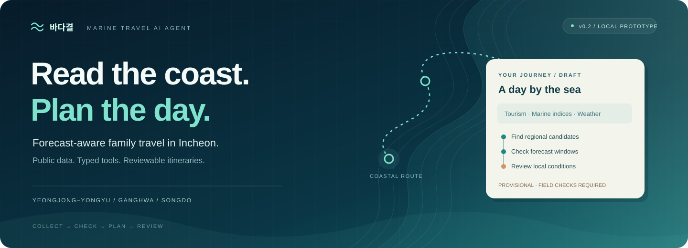
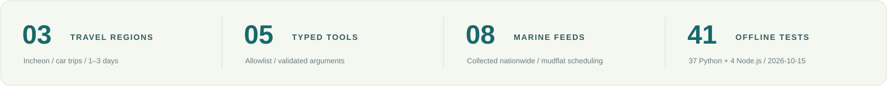
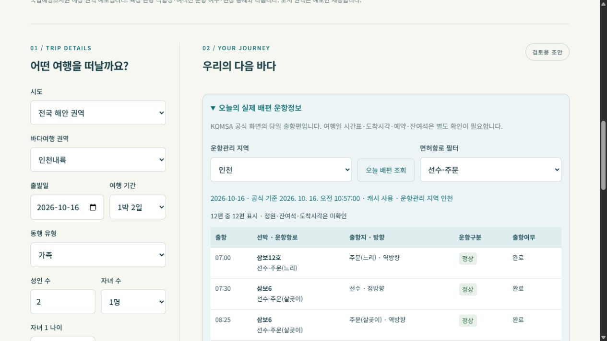
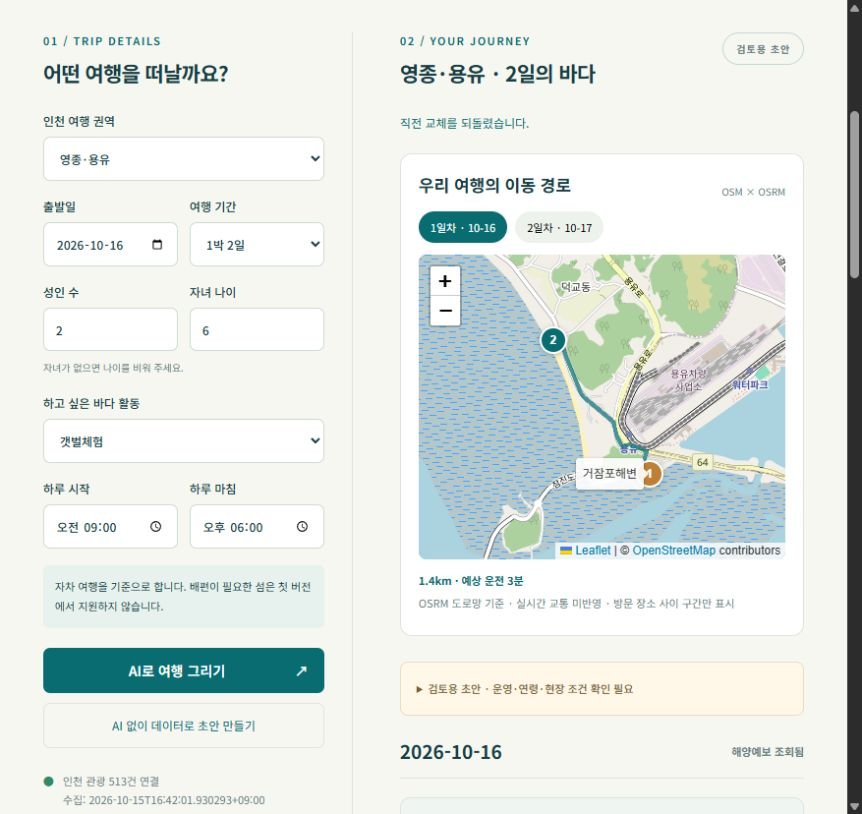
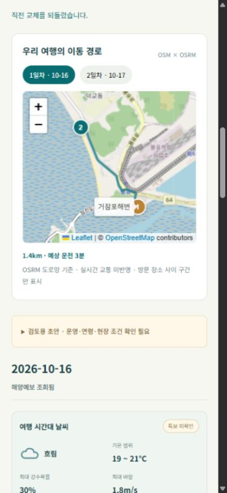
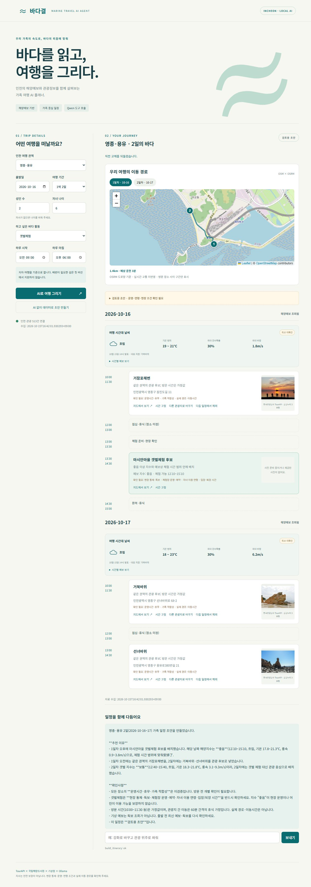
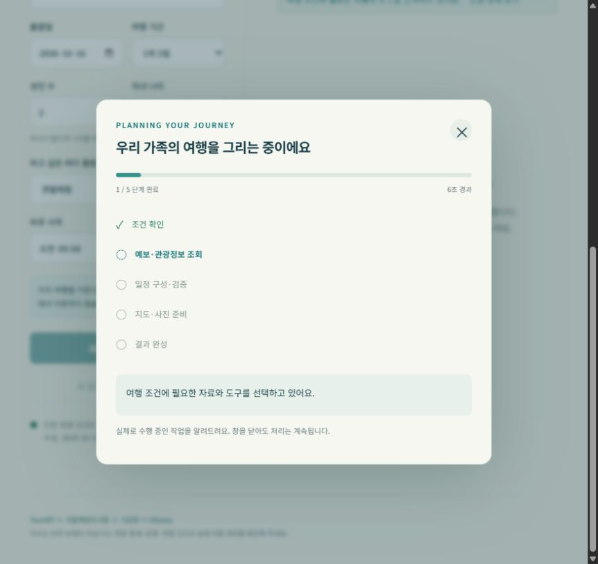
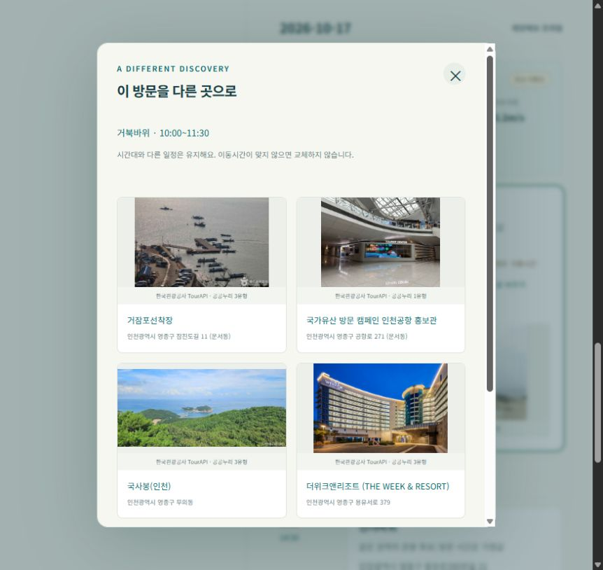
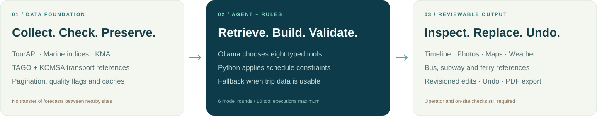
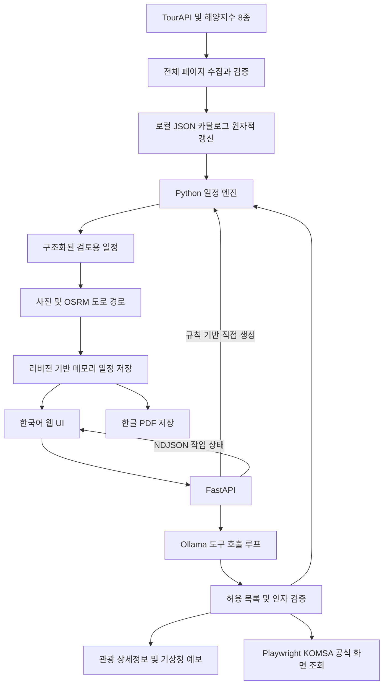

<div align="center">



# Marine Travel AI Agent · 바다결

### 공공데이터 → 제한된 도구 호출 → 근거를 확인하는 여행 초안

**바다결**은 관광정보·해양예보·날씨를 동행 유형에 맞는 여행 일정으로 연결합니다.

[English](README.md) | [한국어](README.ko.md)

[화면 살펴보기](#preview--화면) · [바로 실행](#quick-start--실행) · [데이터 기반](#data-foundation--데이터-기반) · [검증](#validation--검증) · [English](README.md)


</div>



## About · 소개

**바다결**은 TourAPI 관광정보, 국립해양조사원 생활해양예보지수, 기상청 단기예보를 결합해 **전국 해안의 개인·커플·가족·단체 여행 검토용 일정**을 만드는 AI 에이전트입니다. **전국 29개 바다여행 예보 권역**을 비교하고 **24개 육상 관광 권역의 1~3일 자차·도보 초안**을 지원합니다. 기존 인천 세부 권역도 유지합니다.

설계의 중심은 **원천 레코드에서 구조화된 일정까지 추적 가능한 흐름**입니다. Ollama는 형식이 정해진 도구를 선택하고 결과를 설명합니다. Python은 시간·고정 방문 조건을 적용합니다. 화면은 경로·출처·예보 시각·미확인 항목을 함께 보여주어 사용자가 결과를 검토할 수 있게 합니다.

> **v0.5 · 로컬 프로토타입 · 한국어 UI.** 운영 여부·자녀 이용 연령·특보·현장 통제는 별도 확인이 필요하며, 모든 일정은 검토용 초안입니다.

최신 v0.4 캡처: [전국 비교](docs/national-desktop.jpg) · [모바일](docs/national-mobile.jpg) · [강릉 초안](docs/national-plan.jpg). 이전 v0.3 캡처: [전체 화면](docs/interface-v03.jpg) · [날씨 좌우 탐색](docs/weather-v03.jpg) · [390px 모바일](docs/mobile-v03.jpg). 기존 갤러리의 v0.2 화면도 참고용으로 유지합니다.

## v0.5 추가 기능

| 기능 | 동작과 범위 |
| --- | --- |
| **일정 PDF 저장** | 현재 저장된 일정 버전의 방문·날씨·식당·이동정보를 한글 PDF로 내려받습니다. 사진과 인터랙티브 지도는 웹에서 확인합니다. |
| **관광 후보 정리** | 문화회관·도서관·일반 공공시설·체육시설 등을 자동 추천에서 제외하고 박물관·미술관·기념관·전시관은 유지합니다. 현재 관광 유형 5,176건 중 81건을 제외하며 이후 권역·접근 검사를 적용합니다. 시설 품질·운영 여부 검증을 뜻하지 않습니다. |
| **실제 배편 운항정보** | Playwright로 KOMSA 공식 화면의 오늘 출항시각·선박·항로·운항상태를 읽습니다. 운항관리 지역과 면허항로로 좁힐 수 있으며 Qwen도 여섯 번째 도구 `get_ferry_operations`로 조회합니다. |

**배편 연동 범위:** 당일 출항 관측만으로 도착시각·미래 시간표·잔여석·예약을 확인할 수 없습니다. 해당 값은 미확인으로 두며 섬 일정을 자동 활성화하지 않습니다. 도서 예보 5개 권역은 날짜별 왕복편과 접근 검증 전까지 예보 전용입니다. [설치·API·제한](docs/API-v05.md).



## v0.4에서 이어지는 전국 지원

전국 29개 바다여행 예보를 오전·오후 또는 일 단위로 비교하고 시도·권역을 선택해 관광 초안을 만듭니다. 10개 시도 관광정보 10,102건을 수집했으며 실제 편성 후보는 행정구역과 자체 탐색 범위로 좁힙니다. 지수가 나쁘면 일반 시설 제외 후 남은 문화 관광 후보를 우선합니다.

**24개 육상 관광 권역에서 초안을 지원**합니다. 인천북서·인천남서·신안북동·신안남서·여수도서는 배편 검증 전까지 예보만 제공합니다. [지원 범위·인터페이스·수집 방법](docs/API-v04.md)을 참고하세요.

## v0.3 추가 기능

일별 시작·마침, 하루 방문 개수, 동행 유형·자녀 수, 도보 경로, 음식 종류별 식당·중간 카페, 좌우 날씨 탐색, 일별·전체 바다여행지수 전망을 추가했습니다.

**대중교통은 Playwright로 네이버 지도 화면을 조회하며 별도 대중교통 API 키가 필요하지 않습니다.** 조회 시점의 참고 경로이며 여행일 시간표 검증은 미지원입니다. `python -m playwright install chromium`으로 브라우저를 설치하세요. [설치·동작·제한](docs/BROWSER_TRANSIT.md)을 참고하세요. 배편은 최신 왕복 검증 자료가 필요하며 활성화한 섬은 없습니다.

## Preview · 화면

<table>
<tr>
<td width="68%" valign="top">

<p><strong>조건과 경로를 함께.</strong> 권역·날짜·가족 구성을 입력하고 초안 옆에서 도로 경로를 확인합니다.</p>
</td>
<td width="32%" valign="top">

<p><strong>이동 중에도 검토.</strong> 모바일에서 일정과 확인 사항을 함께 살펴봅니다.</p>
</td>
</tr>
</table>

<details>
<summary><strong>전체 일정·작업 진행 팝업·대체 관광지 보기</strong></summary>



| 작업 진행 상태 | 대체 관광지 |
| --- | --- |
|  |  |

</details>

<sub>기존 개발 화면입니다. 표시된 날짜·사진·예보는 당시 기록이며 현재 서비스 상태를 뜻하지 않습니다.</sub>

## Highlights · 주요 기능

<table>
<tr>
<td width="33%" valign="top"><strong>01 / 제한된 도구 호출</strong><p>도구 6종 허용 목록과 Pydantic 인자 검증. 요청당 모델 라운드 최대 6회·도구 실행 최대 10회.</p></td>
<td width="33%" valign="top"><strong>02 / 데이터 무결성</strong><p>전체 페이지 수집, 총건수 변동·중복 검사, 원자적 스냅샷 갱신, 명시적인 최신성 조건.</p></td>
<td width="34%" valign="top"><strong>03 / 예보 시간 반영</strong><p>갯벌체험 가능 시간·좋은 지수에 준비·환복·고정 방문 조건을 함께 적용.</p></td>
</tr>
<tr>
<td valign="top"><strong>04 / 근거가 보이는 화면</strong><p>NDJSON 작업 상태, 출처 시각, 시간대별 날씨, 동일 ID 사진, 날짜별 OSRM 도로 지도.</p></td>
<td valign="top"><strong>05 / 방문 하나만 수정</strong><p>LLM 재호출 없이 관광지 하나를 교체. 인접 이동시간 검사, 방문 고정, 직전 교체 되돌리기.</p></td>
<td valign="top"><strong>06 / 모델 실패 대응</strong><p>여행 입력과 원천 데이터가 사용 가능하면 Python 규칙 기반 초안과 대체 처리 상태를 제공.</p></td>
</tr>
</table>

해양지수 **8종 수집**과 **자동 일정 편성 범위**는 다릅니다. 현재 자동 편성하는 해양 활동은 **갯벌체험**이며, 해수욕과 나머지 해양 활동은 자동 일정으로 구현하지 않았습니다.

## Architecture · 구조



<details>
<summary><strong>컴포넌트 구조도와 실행 원칙</strong></summary>



**에이전트의 역할:** [`agent.py`](marine_agent/agent.py)에 `find_family_places`, `get_marine_conditions`, `get_place_details`, `get_weather`, `build_itinerary`, `get_ferry_operations`가 등록되어 있습니다. 도구 이름·인자를 검사한 뒤 실행하며, 폼 여행 입력이 있으면 모델이 만든 여행 인자보다 우선합니다. 도구 실행 상태를 확인할 수 있지만, 최종 AI 설명의 사실 정확성을 보장하지는 않습니다.

**일정 엔진의 역할:** 초기 배치는 권역 좌표 범위, 직선거리 후보 필터, 체류시간 가정을 사용합니다. OSRM 경로는 이후 추가하므로 최초 초안에 이동시간 부족 경고가 남을 수 있습니다. 관광지를 교체할 때는 기존 시간표를 유지한 채 인접 도로 경로와 여유 시간을 검사합니다.

</details>

| 도구 | 역할 |
| --- | --- |
| `find_family_places` | 권역별 관광 후보 조회. 가족 적합성은 미검증. |
| `get_marine_conditions` | 활동·날짜별 권역 해양예보 조회. |
| `get_place_details` | 알려진 관광지 ID의 TourAPI 상세정보 조회. |
| `get_weather` | 알려진 관광지 좌표를 기상청 격자로 변환해 예보 조회. |
| `build_itinerary` | 여행 제약을 적용해 구조화된 검토용 일정 생성. |

## Data foundation · 데이터 기반

파이프라인은 **원천의 레코드 단위·수집 시각·미확인 상태**를 보존합니다. 관광지·해양예보·날씨는 서로 다른 데이터이며, 연결했다는 사실만으로 운영 여부나 어린이 적합성이 검증되지는 않습니다.

| 계층 | 레코드 의미 | 품질 처리와 한계 |
| --- | --- | --- |
| 관광 카탈로그 | `contentid`로 구분하는 10개 해안 시도 TourAPI 항목. | ID 중복 검사, 행정코드 조인, 자체 탐색 범위·도로 접근 검사. |
| 해양 카탈로그 | 지점·날짜 및 서비스별 차원을 갖는 전국 예보 레코드. | 8종 전체 페이지·건수 검사. 해양 편성은 한국시간 당일 수집 조건. 행 수는 고유 체험장 수가 아님. |
| 날씨 | 기상청 격자별·날짜별·시간별 예보 요소. | 좌표를 격자로 변환하고 발표 시각·기준 장소 보존. 특보 조회는 미구현. |
| 부가정보 | 관광지 ID별 사진 메타데이터와 좌표쌍별 도로 경로. | ID·허용 이용 유형 확인. 미제공 사진·경로를 생성해 채우지 않음. |

**현재 수집본:** 2026년 10월 16일 00:16 KST 기준 관광 **10,102건·고유 ID 10,102개**, 바다여행 **29개 예보 권역**입니다. [전국 집계 프로파일](docs/national-profile.json)을 참고하세요. 다른 해양 피드는 원래 수집 시각을 유지합니다.

**이전 v0.3 로컬 스냅샷:** 2026년 10월 15일 16:42:01 KST 수집본에 **관광 513건·고유 ID 513개·기본 국내 좌표 범위 통과 511건·전국 해양예보 3,827행**이 있습니다. 관광 2건은 해당 좌표 검사를 통과하지 못했습니다. 기존 파일을 검사한 수치이며 새 API 수집이나 위치 정확도 검증 결과는 아닙니다.

피드별 건수·후보 필터·최신성 조건·품질 검사의 범위는 [DATA.md](docs/DATA.md)에 정리했습니다.

## Quick start · 실행

### 1. 설치

**Python 3.11 이상**, Windows PowerShell 기준입니다.

```powershell
python -m venv .venv
.\.venv\Scripts\python.exe -m pip install -r requirements.txt
Copy-Item .env.example .env
```

대중교통·실제 배편 조회에는 `python -m playwright install chromium`이 필요합니다. PDF는 ReportLab으로 한글 TTF를 포함합니다. Windows는 맑은 고딕을 자동 감지하고 Linux는 `fonts-nanum` 설치 또는 `PDF_FONT_PATH` 설정이 필요합니다.

### 2. 서비스 설정

[`.env.example`](.env.example)을 참고해 `.env`를 설정합니다.

| 환경변수 | 용도 / 기본값 |
| --- | --- |
| `MARINE_CREDENTIALS_FILE` | 외부 API 키 문서의 절대 경로. 수집·원천 API 호출에 필요. |
| `OLLAMA_BASE_URL` | Ollama 서버 주소. 기본 `http://localhost:11434`. |
| `OLLAMA_MODEL` | 기본 `qwen3.8:27b-mtp-q8_0`. 도구 호출이 가능한 모델을 서버에 별도 설치. |
| `OLLAMA_NUM_CTX` | 모델 문맥 설정. 기본 `16384`. |
| `OSRM_BASE_URL` | 도로 경로 제공 주소. 기본 `https://router.project-osrm.org`. |
| `TRANSIT_PROVIDER` | 기본 `playwright`: 네이버 지도 화면의 참고 경로. `disabled`로 조회 중지. [설치·제한](docs/BROWSER_TRANSIT.md). |
| `PDF_FONT_PATH` | 한글 TTF 경로 재정의. Windows 맑은 고딕 자동 감지; Linux는 `fonts-nanum` 또는 이용 가능한 한글 TTF 필요. |
| `OSM_TILE_URL` | 지도 타일 템플릿. 기본 `https://tile.openstreetmap.org/{z}/{x}/{y}.png`. |

기본 모델 이름은 코드의 설정값이며, 모델 파일은 포함하지 않습니다. 하드웨어별 실행 가능 사양을 검증한 프로젝트도 아닙니다. Ollama는 같은 PC 또는 별도 서버를 사용할 수 있으며, 공공 API·도로 경로·지도 타일에는 네트워크 연결이 필요합니다.

API 키 문서는 저장소 밖에 두고, 서비스마다 다음 세 줄을 작성한 뒤 빈 줄로 구분합니다.

```text
한국관광공사_국문 관광정보 서비스_GW
엔드포인트 : https://apis.data.go.kr/B551011/KorService2
키 : YOUR_SERVICE_KEY

기상청_단기예보 조회서비스
엔드포인트 : https://apis.data.go.kr/1360000/VilageFcstInfoService_2.0
키 : YOUR_SERVICE_KEY
```

해양 서비스 8종도 같은 형식으로 추가합니다. 필요한 엔드포인트 접미사는 [`providers.py`의 `MARINE`](marine_agent/providers.py)에 있습니다. 일정 사진은 관광지 ID에 연결된 TourAPI 이미지를 사용하므로 별도 관광사진 검색 API는 필요하지 않습니다.

### 3. 수집과 실행

```powershell
.\.venv\Scripts\python.exe -m marine_agent.sync
.\run.ps1
```

[http://127.0.0.1:8001](http://127.0.0.1:8001)을 엽니다. API 문서는 [/docs](http://127.0.0.1:8001/docs)에서 확인할 수 있습니다. 매일 사용 전 카탈로그를 갱신하세요. 새로 복제한 저장소에는 인증정보·수집 데이터·모델 가중치가 포함되어 있지 않습니다.

Linux/macOS에서는 `.venv/bin/python`을 사용하고 다음 명령으로 실행합니다.

```bash
.venv/bin/python -m uvicorn marine_agent.app:app --host 127.0.0.1 --port 8001
```

Windows 가상환경에서 pip 초기화가 실패하면 `python -m pip --python .venv/Scripts/python.exe install -r requirements.txt`를 사용할 수 있습니다.

## Validation · 검증

**2026년 10월 16일 한국시간 기준 재실행: Python 102개, 프런트엔드 11개 테스트 통과.** Starlette/httpx 사용 중단 예정 경고 1건이 발생했습니다. 합성 데이터·모의 응답을 쓰는 오프라인 검사이므로 실제 API 연결이나 모델 품질을 보장하는 결과는 아닙니다.

| 근거 | 확인 범위 |
| --- | --- |
| Python 회귀 테스트 | 예보 시간, 누락·오래된 자료·폐장, 고정 일정, 페이지 수집, 원자적 갱신, 모델 실패 전환, HTTP 검증, 사진·경로 및 일정 교체. |
| Node.js 테스트 | 날씨 표시 규칙, 한국시간, 한글 UTF-8 분할 NDJSON 파싱, 불완전 스트림 오류. |
| 기존 개발 기록 | 원천 API·Ollama·사진·도로 경로·브라우저 관찰은 [VALIDATION.md](VALIDATION.md)에 과거 근거로 구분해 보존. |
| 로컬 문서·데이터 검사 | 기존 카탈로그 집계 및 README 1280px 로컬 렌더링. 이미지 누락·가로 넘침 없음. |
| CI 설정 | [GitHub Actions](.github/workflows/ci.yml)에 Python 3.11·Node.js 22 설정. 오프라인 CI는 실제 제공기관 조회나 Chromium 실행을 포함하지 않습니다. 원격 실행 상태는 연결된 워크플로에서 확인합니다. |

```powershell
.\.venv\Scripts\python.exe -m pip install -r requirements-dev.txt
.\.venv\Scripts\python.exe -m pytest -q --basetemp=.tmp/pytest
node --test tests/web.test.mjs
```

프런트엔드 테스트에는 **Node.js 18 이상**이 필요하며 npm 패키지 설치는 필요하지 않습니다. 상세 근거와 미검증 항목은 [검증 기록](VALIDATION.md)을 참고하세요.

## API · 인터페이스

| 메서드 | 경로 | 용도 |
| --- | --- | --- |
| GET | `/api/health` | 카탈로그 유무·수집 시각·건수. |
| GET | `/api/places` | 권역별 관광 후보. |
| POST | `/api/plan` | Python 규칙 기반 초안. |
| POST | `/api/chat` | Ollama 도구 호출과 설명. |
| POST | `/api/chat/stream` | NDJSON 진행 상태와 최종 결과. |
| POST | `/api/plans/{plan_id}/replace` | 교체 가능한 관광 방문 하나 변경. |
| POST | `/api/plans/{plan_id}/undo` | 직전 교체 되돌리기. |
| POST | `/api/plans/{plan_id}/lock` | 방문 고정·해제. |
| GET | `/api/config` | 공개 설정·버전·배편 운항관리 지역. |
| GET | `/api/plans/{plan_id}/pdf?revision=N` | 저장된 버전의 한글 PDF; 충돌·만료 검사. |
| GET | `/api/ferries/live?office=인천&date=YYYY-MM-DD` | 공식 화면의 오늘 출항·운항정보; 도착 미확인은 null. |

[v0.5 PDF·배편 계약](docs/API-v05.md)과 [v0.2 리비전·스트림 계약](docs/API-v02.md)을 참고하세요.

## Notes · 참고

- **현장 이용 가능성:** 운영시간·예약·자녀 이용 연령·특보·현장 통제·주차장 접근은 미검증입니다. 좋은 지수가 안전한 출입이나 가족 적합성을 의미하지 않습니다.
- **예보 해석:** 해양예보 누락·오래된 자료는 체험 편성 근거로 사용하지 않습니다. 날씨 누락도 좋은 날씨로 해석하지 않지만, 해양지수 조건을 충족하면 기상 미확인 안내와 함께 후보를 편성할 수 있습니다. 날씨는 표시된 대표 관광 후보 좌표 기준이며 전체 방문지의 예보를 검증하지 않습니다.
- **배치 가정:** 갯벌체험 60분, 준비·환복 각 30분, 관광 90분은 설계 가정입니다. 초기 배치는 최적 경로를 보장하지 않습니다. 도로 시간은 실시간 교통을 반영하지 않으며 배편은 검증된 당일 왕복 자료가 필요하며 차량 선적·섬 숙박·출발항까지의 접근은 지원하지 않습니다.
- **실행 범위:** Uvicorn 단일 워커를 사용합니다. 일정은 프로세스 메모리에 최대 128개·생성 후 2시간 보관되며 재시작 시 사라집니다. AI 대화 생성은 동시에 한 건만 처리합니다. 인증 없는 로컬 개발용이므로 루프백으로 실행합니다.
- **데이터·이미지:** `.env`, `data/`, 가상환경, 실제 대화 보고서는 Git에서 제외합니다. 사진은 관광지 ID와 허용 이용 유형을 확인한 경우 표시합니다. 원천 문구·사진·Leaflet·지도 데이터의 이용조건은 각각 적용됩니다.

캐시·문제 해결·GitHub About 설정 문구는 [운영 참고 문서](docs/NOTES.md)에 있습니다.

## Repository guide · 폴더 안내

| 경로 | 역할 |
| --- | --- |
| [`marine_agent/agent.py`](marine_agent/agent.py) | 도구 스키마·호출 제한·모델 실패 전환. |
| [`marine_agent/pdf_export.py`](marine_agent/pdf_export.py) / [`browser_ferries.py`](marine_agent/browser_ferries.py) | 저장 일정 PDF와 공식 당일 배편 관측. |
| [`marine_agent/planner.py`](marine_agent/planner.py) | 여행 제약과 규칙 기반 일정 생성. |
| [`marine_agent/providers.py`](marine_agent/providers.py) | 페이지 수집·카탈로그 갱신·관광 상세·날씨. |
| [`marine_agent/plans.py`](marine_agent/plans.py) / [`enrichment.py`](marine_agent/enrichment.py) | 일정 리비전·고정·되돌리기·사진·경로. |
| [`marine_agent/app.py`](marine_agent/app.py) / [`web/`](web/) | HTTP·스트림 API와 한국어 화면. |
| [`scripts/`](scripts/) / [`tests/`](tests/) | 연결·비밀정보 검사와 오프라인 회귀 테스트. |
| [`docs/`](docs/) / [`reports/data_connections.json`](reports/data_connections.json) | 인터페이스 문서·화면·날짜가 명시된 연결 근거. |
| [`docs/DATA.md`](docs/DATA.md) / [`data-profile.json`](docs/data-profile.json) | 데이터 단위·후보 필터·최신성 조건·날짜별 집계 근거. |

## Roadmap · 개발 계획

다음 우선순위는 운영·자녀 연령 확인, 특보·출입 통제 연계, 주차·교통을 포함한 이동 가능성 검증, 한국어 도구 호출 평가 확대입니다. 공유 저장소·인증·배포 모니터링은 후속 과제입니다. [전체 로드맵](docs/ROADMAP.md)을 참고하세요.

## Sources · 출처와 이용조건

프로젝트에 기록된 원천 출처는 [TourAPI](https://www.data.go.kr/data/15101578/openapi.do), [국립해양조사원 갯벌체험지수](https://www.data.go.kr/data/15142489/openapi.do), [기상청 API Hub](https://apihub.kma.go.kr/)입니다. 배편은 [KOMSA 공식 운항정보 화면](https://www.komsa.or.kr/prog/pssgCurState/kor/sub03_0202/list.do)을 사용합니다. Playwright·ReportLab·Ollama·OSRM·Leaflet/OpenStreetMap을 함께 사용합니다. Leaflet 1.9.4와 [BSD 라이선스](web/vendor/leaflet/LICENSE)는 저장소에 포함되어 있습니다.

현재 프로젝트 전체에 적용되는 라이선스 파일은 없습니다. 의존성 라이선스와 공공데이터·이미지 이용조건은 별도로 적용됩니다.

### 방문 사이 이동 카드

관광지·식당·카페 사이에 이동수단·예상 시간·확보된 거리를 표시합니다. 지도 버튼으로 해당 구간을 강조하며, 대중교통은 상세 노선·승하차 지점을 펼쳐볼 수 있습니다. 사진 출처는 사진 아래에서 일정 하단의 접힌 사진 이용정보로 옮겼습니다. 배편은 [v0.5 당일 공식 화면 조회](docs/API-v05.md)까지 연결했으며, 도착시각·왕복편 검증이 필요한 섬 자동 편성은 아직 활성화하지 않았습니다.
