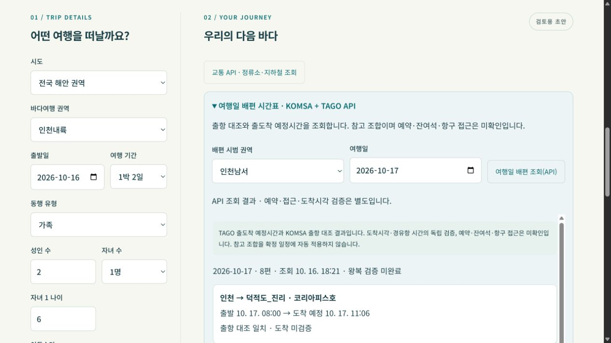
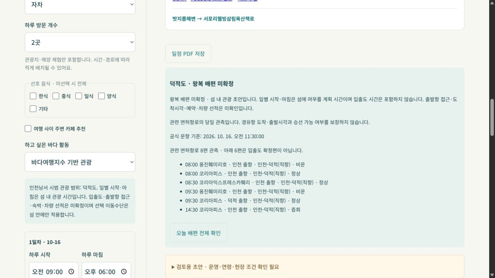
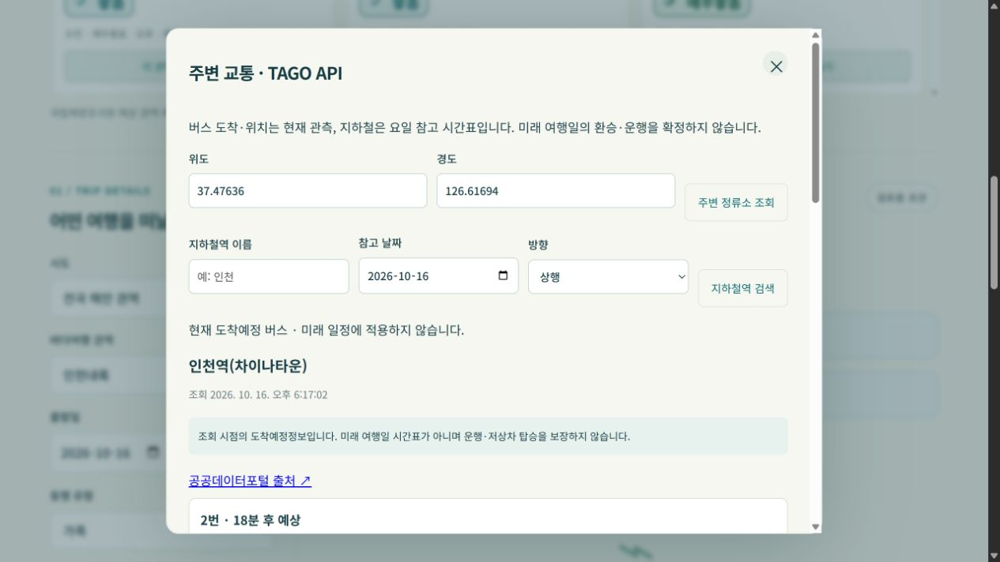
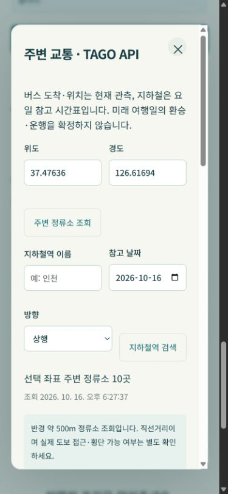
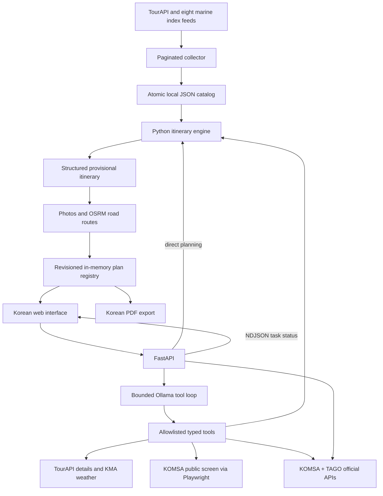

<div align="center">


# Marine Travel AI Agent

### Public data → Bounded tools → A journey you can inspect

**바다결** brings tourism, marine forecasts and weather into a travel draft for solo travelers, couples, families and groups.

[English](README.md) | [한국어](README.ko.md)

[Explore the interface](#preview) · [Quick start](#quick-start) · [Data foundation](#data-foundation) · [Validation](#validation) · [한국어](README.ko.md)


</div>


## About

**Marine Travel AI Agent** combines Korean tourism records, marine activity forecasts and coordinate-based weather forecasts into provisional travel itineraries. Its Korean interface, **바다결**, supports **one- to three-day car or walking trips** across **29 nationwide forecast-linked scopes: 25 ground/bridge scopes and four conditional on-island scopes**, with the existing Incheon presets retained.

The engineering focus is **a traceable path from source records to a structured itinerary**. Ollama selects typed tools and explains results. Python applies time-window and reservation rules. The interface exposes routes, source links, forecast timestamps and unresolved checks so a user can review the result.

> **v0.6.0 · Local prototype · Korean UI.** Operator availability, age restrictions, warning bulletins and on-site access require separate verification. Every generated trip is provisional.

## New in v0.6 — Official transport API evidence

Seven authenticated services now provide nearby stops, current bus arrivals, route stops and vehicle positions, subway reference timetables, and dated ferry references. Open **교통 API · 정류소·지하철 조회**, a visit’s **주변 교통(API)**, or **여행일 배편 시간표** in the Korean UI. Qwen can call two additional typed tools.

Ferry departures are reconciled by date, vessel, port and departure minute. Arrival inconsistencies are flagged; reference round trips are **not automatically applied**. Seats, bookings, terminal access and arrival accuracy remain unverified. General transit routing continues through the existing browser provider.

[API setup, quality gates and endpoints](docs/TRANSPORT_API.md) · [Live validation evidence](reports/transport-connections.json)



## New in v0.5.1 — Island tourism drafts

Previously disabled offshore selections now provide explicit pilot tourism drafts:
**Incheon northwest → Baengnyeongdo; Incheon southwest → Deokjeokdo; Sinan
northeast → Jeungdo; Sinan southwest → Heuksando; Yeosu islands → Geomundo.**
Jeungdo uses a bridge-connected scope; the other four return `conditional_island`.

The planner uses exact island attraction IDs, local routes and the selected
region's sea-travel outlook. Today's related KOMSA observations appear beside the
draft. **Daily hours are planned time on the island; ferry crossings, mainland
access, lodging and vehicle shipping are unconfirmed.** Future travel dates do
not reuse today's sailings. PDF, replacement and undo retain this access caveat.
[Pilot scope, data contract and remaining work](docs/ISLAND_DRAFTS.md).



## Added in v0.5

| Feature | Behavior and boundary |
| --- | --- |
| **Save itinerary as PDF** | Export the current stored revision with Korean text, daily visits, weather, meals and transfer details. Photos and interactive maps remain in the web view. |
| **More focused attraction candidates** | Exclude generic culture halls, libraries, public facilities and sports venues from automatic suggestions; retain museums, galleries, memorials and exhibitions. The current catalog excludes 81 of 5,176 tourism-type records before regional/access filtering. This is a selection policy, not a venue-quality assessment. |
| **Actual ferry operations** | Playwright reads the public KOMSA screen for today's departures, vessels, routes and operation status. Select an operations office and filter by licensed route. A sixth typed tool, `get_ferry_operations`, makes the same observation available to Qwen. |

**Ferry scope:** today's observed departures do not establish arrival times, future timetables, seats or bookings. The adapter leaves these unknown. v0.5.1 provides conditional island tourism drafts, while complete dated round-trip access remains unverified. [Setup, endpoints and limits](docs/API-v05.md).


## National coverage retained from v0.4

Compare morning/afternoon or daily sea-travel grades across **29 forecast regions**, select a province and region, then request a local trip draft. **25 scopes now support ground/bridge tourism and four support conditional island drafts**; the latter require independent round-trip verification. The atomic collection covers **10,102 TourAPI records in ten coastal provinces**; only eligible local candidates enter a draft.

Poor sea outlooks prioritize eligible cultural-attraction candidates after facility exclusions. Source grades, missing coverage, route checks and the actual forecast-date range stay visible. Search regions are application filters, not official forecast polygons. See [coverage, API and collection details](docs/API-v04.md).

## Added in v0.3

Daily time windows, attraction counts, party types and child counts; nearby meals by TourAPI cuisine and cafe breaks; horizontally scrollable weather; daily and whole-trip sea-travel outlooks. Walking uses a separate OSRM foot graph.

**Transit now uses Playwright and the rendered Naver Map UI without a transit API key.** It shows lookup-time reference routes, not travel-date timetable verification. Install Chromium with `python -m playwright install chromium`. See [browser setup and limits](docs/BROWSER_TRANSIT.md). The separate reviewed round-trip scheduler has no enabled manifest; conditional on-island drafts are available as described above.

Current v0.4 captures: [national comparison](docs/national-desktop.jpg), [mobile](docs/national-mobile.jpg), [Gangneung draft](docs/national-plan.jpg). Earlier v0.3 captures: [full interface](docs/interface-v03.jpg), [weather scrolling](docs/weather-v03.jpg), [390px mobile](docs/mobile-v03.jpg). The main preview shows v0.6 transport screens; the expandable gallery retains v0.2 development captures.

## Preview

<table>
<tr>
<td width="68%" valign="top">

<p><strong>Plan with context.</strong> Inspect official bus route information, ordered stops and current vehicle-position references.</p>
</td>
<td width="32%" valign="top">

<p><strong>Review on the move.</strong> The mobile transport dialog shows nearby stops and explains the limits of live and future-day information.</p>
</td>
</tr>
</table>

<details>
<summary><strong>Open the full itinerary, task-progress dialog and alternative visits</strong></summary>


| Task progress | Alternative visits |
| --- | --- |
|  |  |

</details>

<sub>Main preview: v0.6 transport screens, captured October 16, 2026. Expandable gallery: earlier v0.2 screens. Captures are dated observations, not current service status.</sub>

## Highlights

<table>
<tr>
<td width="33%" valign="top"><strong>01 / Bounded tool use</strong><p>Eight allowlisted tools, Pydantic arguments, six model rounds and ten tool executions maximum per request.</p></td>
<td width="33%" valign="top"><strong>02 / Data integrity</strong><p>Complete pagination, stable-total and duplicate checks, atomic snapshots, and explicit freshness gates.</p></td>
<td width="34%" valign="top"><strong>03 / Forecast windows</strong><p>Mudflat experience windows are combined with favorable indices, preparation, changing and fixed visits.</p></td>
</tr>
<tr>
<td valign="top"><strong>04 / Visible evidence</strong><p>NDJSON task status, source timestamps, hourly weather, exact-ID photos and daily OSRM route maps.</p></td>
<td valign="top"><strong>05 / Precise edits</strong><p>Replace one tourism visit without another LLM call. Check adjacent mode-specific route gaps, lock visits and undo the last replacement.</p></td>
<td valign="top"><strong>06 / Degraded operation</strong><p>With usable trip inputs and source data, a model failure can return a Python-generated draft with fallback status.</p></td>
</tr>
</table>

Eight marine feeds are collected, but **only mudflat experiences are automatically scheduled**. Swimming and the other marine activities are not implemented as automatic itinerary slots.

## Architecture


<details>
<summary><strong>Component diagram and execution contracts</strong></summary>



**Agent contract.** `find_family_places`, `get_marine_conditions`, `get_place_details`, `get_weather`, `build_itinerary`, `get_ferry_operations`, `get_ferry_timetable` and `get_nearby_transport` are registered in [`agent.py`](marine_agent/agent.py). Tool names and arguments are checked before execution. When a form trip is supplied, its values take precedence over model-generated trip arguments. Tool traces expose execution status; final model prose can still be inaccurate.

**Planning contract.** The itinerary uses source administrative joins and explicit search filters for national regions; legacy Incheon presets retain their rectangles. Visit durations remain assumptions. OSRM routes are added afterward, so an initial draft can carry travel-gap warnings. Replacing a visit requires available adjacent routes that fit the existing free time.

</details>

| Tool | Responsibility |
| --- | --- |
| `find_family_places` | Retrieve regional tourism candidates; family suitability is unverified. |
| `get_marine_conditions` | Retrieve a date/activity-specific regional marine forecast slice. |
| `get_place_details` | Fetch TourAPI details for a known tourism content ID. |
| `get_weather` | Fetch KMA grid forecasts from a known place's coordinates. |
| `build_itinerary` | Apply trip constraints and return a structured provisional schedule. |
| `get_ferry_timetable` | Retrieve dated pilot ferry references with departure reconciliation and explicit arrival/access limits. |
| `get_nearby_transport` | Retrieve nearby source bus stops for public place coordinates. |
| `get_ferry_operations` | Read today’s KOMSA public departure/operation screen; no verified arrivals or bookings. |

## Data foundation

The pipeline preserves **source grain, collection time and unknowns**. Tourism records, marine forecast rows and weather forecast elements are different entities; joining them does not establish that an operator is open or an activity is suitable for a child.

| Layer | Record meaning | Quality controls and boundaries |
| --- | --- | --- |
| Tourism catalog | Ten coastal provincial TourAPI catalogs, identified by `contentid`. | Unique IDs; planning uses source administrative codes, explicit regional filters and road-access screening. |
| Marine catalog | National forecast record for a source site/date and feed-specific dimensions. | Eight feeds; full-page/count checks; same-Korean-day freshness for marine scheduling. Counts are not unique venue counts. |
| Weather | KMA grid forecast elements by date and hour. | Coordinate-to-grid conversion; issue time and reference point retained. Warning bulletins are not queried. |
| Enrichment | Tourism-ID photo metadata and coordinate-pair road routes. | Matching IDs and accepted licenses; unavailable photos/routes stay unavailable. |

**Current collection:** October 16, 2026, 00:16 KST — **10,102 tourism records / 10,102 distinct IDs**, **29 sea-travel forecast regions**. See the [national aggregate profile](docs/national-profile.json). Non-sea-travel feeds retain their earlier collection timestamps.

**Historical v0.3 snapshot:** October 15, 2026, 16:42:01 KST — **513 tourism records**, **513 distinct IDs**, **511 coordinate pairs within a basic Korea bounding box**, and **3,827 national marine forecast rows**. Two tourism records failed that coordinate screen. These are dated file observations, not a new API collection or a positional-accuracy assessment.

See [DATA.md](docs/DATA.md) for feed counts, candidate filtering, freshness semantics and what the quality checks cannot prove.

## Quick start

### 1. Install

Use **Python 3.11+**. Windows PowerShell:

```powershell
python -m venv .venv
.\.venv\Scripts\python.exe -m pip install -r requirements.txt
Copy-Item .env.example .env
```

Install Chromium for transit and live ferry lookups: `python -m playwright install chromium`. PDF export uses ReportLab and embeds an available Korean TTF; on Debian/Ubuntu install `fonts-nanum` or set `PDF_FONT_PATH`.

### 2. Configure services

Set the following values in `.env` using [`.env.example`](.env.example):

| Variable | Purpose / default |
| --- | --- |
| `MARINE_CREDENTIALS_FILE` | Absolute path to an external public-API credential document; required for collection and source calls. |
| `TRANSPORT_CREDENTIALS_FILE` | Optional external credential document for the seven official transport services. [Setup](docs/TRANSPORT_API.md). |
| `OLLAMA_BASE_URL` | Ollama server URL; default `http://localhost:11434`. |
| `OLLAMA_MODEL` | Default `qwen3.8:27b-mtp-q8_0`. Install a compatible tool-calling model on your server. |
| `OLLAMA_NUM_CTX` | Model context setting; default `16384`. |
| `OSRM_BASE_URL` | Routing URL; default `https://router.project-osrm.org`. |
| `TRANSIT_PROVIDER` | Default `playwright`: Naver Map UI reference routes; `disabled` turns off transit lookup. [Setup and limits](docs/BROWSER_TRANSIT.md). |
| `PDF_FONT_PATH` | Optional Korean TTF override. Windows detects Malgun Gothic; Linux needs `fonts-nanum` or a licensed Korean TTF. |
| `OSM_TILE_URL` | Map tile template; default `https://tile.openstreetmap.org/{z}/{x}/{y}.png`. |

The default model name is a configuration value, not a bundled model or a hardware requirement validated by this repository. Ollama may run locally or on a separately configured server. Public data, routing and map services still require network access.

Keep API credentials outside the repository. Each service uses a three-line block separated by a blank line:

```text
한국관광공사_국문 관광정보 서비스_GW
엔드포인트 : https://apis.data.go.kr/B551011/KorService2
키 : YOUR_SERVICE_KEY

기상청_단기예보 조회서비스
엔드포인트 : https://apis.data.go.kr/1360000/VilageFcstInfoService_2.0
키 : YOUR_SERVICE_KEY
```

For nationwide sea-travel collection, add the sea-travel service in the same format; refreshing all marine activities requires all eight. Their endpoint suffixes are listed in [`providers.py` → `MARINE`](marine_agent/providers.py). A separate photo-gallery API is not needed for itinerary photos.

### 3. Collect and launch

```powershell
.\.venv\Scripts\python.exe -m marine_agent.sync
.\run.ps1
```

Open [http://127.0.0.1:8001](http://127.0.0.1:8001); API documentation is at [/docs](http://127.0.0.1:8001/docs). Refresh the catalog before daily use. A fresh clone does not include credentials, collected data or model weights.

For Linux/macOS, use `.venv/bin/python` and start the server with:

```bash
.venv/bin/python -m uvicorn marine_agent.app:app --host 127.0.0.1 --port 8001
```

If your Windows Python cannot bootstrap pip inside the environment, use `python -m pip --python .venv/Scripts/python.exe install -r requirements.txt`.

## Between-stop travel cards

Each attraction, restaurant and cafe is connected by an inline travel card with the actual mode, reference duration, known distance and a map-segment button. Transit details expand to show lines and stops; missing routes remain explicit. Photo credits are collected in a collapsed section. The [v0.5 ferry adapter](docs/API-v05.md) reads today's official operations; automatic island scheduling still requires verified round-trip arrivals and access.

## Validation

**Re-run on October 16, 2026 (Asia/Seoul): 123 Python tests and 12 frontend tests passed.** One Starlette/httpx deprecation warning was reported. These offline checks use synthetic data and mocks; they do not establish live-provider availability or model quality. Separate live browser, route and Qwen observations are in [VALIDATION.md](VALIDATION.md).

| Evidence | Scope |
| --- | --- |
| Python regression tests | Forecast windows, missing/stale/closed conditions, fixed visits, pagination, atomic refresh, fallback, HTTP validation, enrichment and revisioned edits. |
| Node.js tests | Weather display rules, Korean local time, split UTF-8 NDJSON parsing and truncated-stream failure. |
| Existing development record | Earlier source, Ollama, route, photo and browser observations are retained separately in [VALIDATION.md](VALIDATION.md). |
| Local documentation/data audit | Existing catalog profiled; README previews rendered locally at 1280px with no missing images or horizontal overflow. |
| CI configuration | Python 3.11 and Node.js 22 are configured in [GitHub Actions](.github/workflows/ci.yml); offline CI does not query providers or run Chromium. See the linked workflow for remote run status. |

```powershell
.\.venv\Scripts\python.exe -m pip install -r requirements-dev.txt
.\.venv\Scripts\python.exe -m pytest -q --basetemp=.tmp/pytest
node --test tests/web.test.mjs
```

Frontend tests need **Node.js 18+**, with no npm dependencies. See the [validation record](VALIDATION.md) for evidence boundaries and untested areas.

## API

| Method | Endpoint | Purpose |
| --- | --- | --- |
| GET | `/api/health` | Catalog availability, collection time and counts. |
| GET | `/api/places` | Regional tourism candidates. |
| POST | `/api/plan` | Python-generated provisional itinerary. |
| POST | `/api/chat` | Ollama tool orchestration and explanation. |
| POST | `/api/chat/stream` | NDJSON task status and final result. |
| POST | `/api/plans/{plan_id}/replace` | Replace one eligible tourism visit. |
| POST | `/api/plans/{plan_id}/undo` | Restore the last replacement. |
| POST | `/api/plans/{plan_id}/lock` | Lock/unlock a visit. |
| GET | `/api/config` | Public configuration, version and ferry operations offices. |
| GET | `/api/plans/{plan_id}/pdf?revision=N` | Download an existing revision as a Korean PDF; conflict/expiry checks apply. |
| GET | `/api/ferries/live?office=인천&date=YYYY-MM-DD` | Today-only public-screen ferry operations; unknown arrivals remain null. |

See [v0.5 export/ferry contracts](docs/API-v05.md) and [v0.2 revision/stream contracts](docs/API-v02.md).

## Notes

- **Travel feasibility:** operating hours, bookings, child age limits, warning bulletins, closures and parking access are unverified. Favorable indices do not establish safe access or family suitability.
- **Forecast interpretation:** missing or stale marine forecasts do not enable marine slots. Missing weather remains unknown; a favorable marine index can still produce a provisional candidate with unchecked weather notices. Weather is queried at a labeled representative tourism point, not every visit.
- **Planning assumptions:** 60-minute mudflat experiences, 30-minute preparation/changing blocks and 90-minute tourism visits are heuristics. Initial scheduling is not a route optimizer. Driving estimates exclude current traffic; reviewed passenger-ferry day trips require separate data and do not include vehicle shipping or mainland-to-port access.
- **Runtime limits:** use one Uvicorn worker. Plans remain in one process for two hours, capped at 128 entries; restarts lose them. One chat generation runs at a time. The prototype has no authentication; use loopback for local development.
- **Data and assets:** `.env`, `data/`, virtual environments and live conversation reports are ignored. Photos require matching tourism IDs and accepted license metadata. Source text, images, Leaflet and map data retain their respective terms.

See [operational notes and GitHub metadata](docs/NOTES.md) for caching, troubleshooting and suggested repository About text.

## Repository guide

| Path | Responsibility |
| --- | --- |
| [`marine_agent/agent.py`](marine_agent/agent.py) | Tool schemas, execution budget and model fallback. |
| [`marine_agent/pdf_export.py`](marine_agent/pdf_export.py) / [`browser_ferries.py`](marine_agent/browser_ferries.py) | Stored-plan PDF and today-only official ferry observations. |
| [`marine_agent/planner.py`](marine_agent/planner.py) | Trip constraints and deterministic schedule construction. |
| [`marine_agent/providers.py`](marine_agent/providers.py) | Pagination, catalog refresh, tourism details and weather. |
| [`marine_agent/plans.py`](marine_agent/plans.py) / [`enrichment.py`](marine_agent/enrichment.py) | Revisions, locks, undo, photos and routes. |
| [`marine_agent/app.py`](marine_agent/app.py) / [`web/`](web/) | HTTP/stream interfaces and Korean frontend. |
| [`scripts/`](scripts/) / [`tests/`](tests/) | Connection/secret checks and offline regression tests. |
| [`docs/`](docs/) / [`reports/data_connections.json`](reports/data_connections.json) | Interface documentation, screenshots and dated connection evidence. |
| [`docs/DATA.md`](docs/DATA.md) / [`data-profile.json`](docs/data-profile.json) | Source grain, filtering, freshness rules and a dated aggregate profile. |

## Roadmap

Next priorities are operator/age verification, warning and access-restriction integration, parking/traffic feasibility, and a larger Korean tool-use evaluation set. Shared persistence, authentication and deployment monitoring are later work. See the [full roadmap](docs/ROADMAP.md).

## Data sources and credits

Source references recorded by the project: [TourAPI](https://www.data.go.kr/data/15101578/openapi.do), [KHOA mudflat forecast index](https://www.data.go.kr/data/15142489/openapi.do), and [KMA API Hub](https://apihub.kma.go.kr/). Actual ferry operations come from the [KOMSA public screen](https://www.komsa.or.kr/prog/pssgCurState/kor/sub03_0202/list.do). Runtime integrations also use Playwright, ReportLab, Ollama, OSRM and Leaflet/OpenStreetMap. Leaflet 1.9.4 is vendored with its [BSD license](web/vendor/leaflet/LICENSE).

No project-wide license file is currently included. Dependency licenses and public-data/image terms apply independently.
