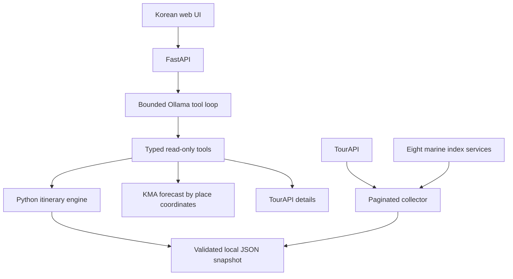

# Marine Travel AI Agent

**Forecast-aware family coastal travel planning, powered by a local tool-calling LLM.**

[한국어 안내](README.ko.md) · [Validation](VALIDATION.md) · [Roadmap](docs/ROADMAP.md)

Marine Travel AI Agent combines Korean tourism data, marine activity indices and
location-specific weather forecasts to produce **provisional family itineraries in
Incheon**. FastAPI runs a bounded Ollama tool loop; Python validates the schedule.
The Korean web interface is provisionally named **바다결**.

<details>
<summary>View the working Korean interface</summary>


</details>

## v0.2 interface

- Live task-progress modal with elapsed time and completed steps; no private model reasoning.
- Embedded Leaflet/OSM daily maps, numbered visits, OSRM road geometry, distances and non-traffic driving estimates.
- Exact-ID TourAPI photos with attribution and license links, preserving image proportions.
- Weather icons, trip-hour summaries and expandable hourly forecasts.
- Single-visit replacement with route/time validation, revision conflicts, lock/unlock and undo.

## Highlights

- Local Ollama / `qwen3.8:27b-mtp-q8_0`, typed arguments, bounded tool calls.
- Fully paginated Incheon TourAPI collection and eight national marine index feeds.
- Yeongjong–Yongyu, Ganghwa, and Songdo–urban Incheon planning areas.
- One- to three-day car trips, family composition, daily time bounds, fixed bookings
  and excluded places.
- Mudflat candidates constrained by favorable indices and forecast experience windows,
  with preparation, changing and rest blocks.
- Missing, stale, unfavorable or closed-site forecasts do not enable marine slots.
- Rule-based fallback when Ollama is unavailable; visible provenance and tool traces.

## Architecture



The first version uses an atomic JSON snapshot before introducing a database.

## Quick start

Python **3.11+**, Windows PowerShell:

```powershell
python -m venv .venv
.\.venv\Scripts\python.exe -m pip install -r requirements.txt
Copy-Item .env.example .env
```

Edit `.env` with your Ollama URL and `MARINE_CREDENTIALS_FILE`. The key document
stays outside the repository. Format each service as three lines, separated by a
blank line:

```text
한국관광공사_국문 관광정보 서비스_GW
엔드포인트 : https://apis.data.go.kr/B551011/KorService2
키 : YOUR_SERVICE_KEY

기상청_단기예보 조회서비스
엔드포인트 : https://apis.data.go.kr/1360000/VilageFcstInfoService_2.0
키 : YOUR_SERVICE_KEY
```

Also include all eight marine services in the same format. See `MARINE` in
[`providers.py`](marine_agent/providers.py) for endpoint suffixes. The photo
service is optional for the checker and is not used by the planner.

```powershell
.\.venv\Scripts\python.exe -m marine_agent.sync
.\run.ps1
```

Open **http://127.0.0.1:8001**. On Linux/macOS use `.venv/bin/python` and
`python -m uvicorn marine_agent.app:app --host 127.0.0.1 --port 8001`.
Refresh the snapshot daily. Keep this unauthenticated prototype on loopback.

If a Windows Python distribution cannot bootstrap pip into the virtual environment:

```powershell
python -m pip --python .venv/Scripts/python.exe install -r requirements.txt
```

## API and tests

| Endpoint | Purpose |
| --- | --- |
| `GET /api/health` | Snapshot availability, counts, timestamp |
| `GET /api/places?region=...` | Regional tourism candidates |
| `POST /api/plan` | Rule-based provisional itinerary |
| `POST /api/chat` | Local LLM tool calling and conversation |
| `POST /api/chat/stream` | NDJSON progress, tool status, final result |
| `POST /api/plans/{id}/replace` | Replace a tourism slot at the same time |
| `POST /api/plans/{id}/undo` | Restore the last replacement |
| `POST /api/plans/{id}/lock` | Lock/unlock a visit, preserving location |
| `GET /api/config` | Public tile configuration (no API credentials) |
| `GET /docs` | OpenAPI documentation |

```powershell
.\.venv\Scripts\python.exe -m pip install -r requirements-dev.txt
.\.venv\Scripts\python.exe -m pytest -q --basetemp=.tmp/pytest
```

Offline tests require neither API keys nor Ollama. The connection checker samples
rows; `marine_agent.sync` validates pagination to reported totals. Live snapshots,
keys, and conversations are ignored by Git. The original connection-check report
is an explicitly dated development record.

## Validation and limits

See [VALIDATION.md](VALIDATION.md). Site operating hours, age limits, road routes,
weather warnings, closures and operator availability are unverified. OSRM routing
is road-network based and does not account for current traffic or parking access. Visit durations
and movement/rest gaps are planning assumptions. Culture facilities are alternative
candidates, not verified indoor venues. Model prose may be inaccurate; review the
structured itinerary and source evidence. There is no optimal-route guarantee.

Plans are stored in one process for two hours, capped at 128 entries. Restarts expire
them. Replacement preserves other visits and checks adjacent driving time against
free gaps excluding preparation and meal blocks. Missing routes reject a replacement;
they never become a straight-line driving route.

The public OSRM server is for prototype use, rate-limited to one uncached request per
second; successful routes are cached for 24 hours. Photo metadata is cached seven days.
Set `OSRM_BASE_URL` and `OSM_TILE_URL` in `.env` to change providers.
Leaflet 1.9.4 and its BSD license are vendored in `web/vendor/leaflet/`.

Only mudflat marine slots are currently scheduled. Swimming awaits site-level
opening, age and local-condition checks. Ferry-dependent trips, turn-by-turn navigation,
reservations and notifications are future work.

## Sources

- [TourAPI](https://www.data.go.kr/data/15101578/openapi.do)
- [KHOA mudflat index](https://www.data.go.kr/data/15142489/openapi.do)
- [KMA API Hub](https://apihub.kma.go.kr/)
- [Ollama tool calling](https://docs.ollama.com/capabilities/tool-calling)

Source text, metadata and images remain subject to their respective terms. Local
API datasets and source image files are not bundled; attributed UI screenshots are included.

Frontend tests require Node.js 18+: `node --test tests/web.test.mjs`. No npm packages are required.
