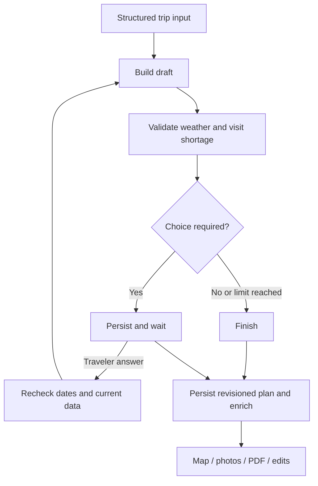

# v0.9 — Local LangGraph journey service

[English README](../README.md) · [한국어 README](../README.ko.md) · [Planning rules](PLANNING_RULES.md)

## Connected flow

The travel form's **AI** and **rule-only** buttons now use a persistent local LangGraph workflow. Qwen/Ollama still selects existing typed tools on the initial AI pass. Python remains responsible for scheduling and validation. No hosted LangGraph server or LangSmith account is required.



- A choice is requested when **the same day** has fewer visits than requested and rain, wind or walking-budget constraints. A generic shortage without those causes retains the existing warning behavior.
- The initial planner already tries alternative placements. After that search, the traveler chooses **finish under current constraints**, **reduce visits**, or **allow transit**. Only meaningful options are offered; transit requires a walking trip, a ready transit connection and no ferry-island walking-only scope.
- Choice handling uses LangGraph `interrupt` / `Command(resume=...)`. At most three successful builds (initial + two rechecks) are allowed. Fixed bookings, exclusions, party and daily hours remain authoritative. Transit is never enabled implicitly.
- Every resumed build validates the trip date again and queries current data. “Finish under current constraints” also rechecks data; it does not certify or freeze stale weather. Rechecks use Python rules rather than paying for another Qwen explanation.
- At the limit, the remaining shortage is disclosed and a provisional result is returned. Explicit retries after failures are separate from successful rechecks; no infinite automatic retry loop is introduced.

## Traveler recovery

The browser retains only an opaque journey ID and random access token in **sessionStorage**, so the same tab can recover after refresh. It does not store the trip or transcript there. The access token is sent in `X-Journey-Token`, never a URL or telemetry event. The database stores only its hash. Losing the tab's storage loses this recovery capability.

The saved-progress panel restores a waiting/completed plan, including photos, map routes and existing slot IDs. During a choice wait, plan mutations and free-form changes are disabled; start a new form request to change other conditions. A modified plan submitted through another client invalidates the pending resume request. Each resume uses an optimistic session revision; stale or duplicate replies cannot silently overwrite a newer result.

Closing the progress dialog or disconnecting the response stream does not cancel the worker. After reload, a running journey is checked every three seconds while visible. On a process restart, previously running journeys are marked **interrupted**, not automatically executed. The traveler can explicitly retry from the saved graph state. Pending choices remain pending across restarts.

“Clear recovery info in this browser” removes the browser reference; it does not immediately delete server state. The normal TTL/capacity policy removes that state. A new request replaces this tab's recovery reference with the new journey's reference.

## Endpoints

| Endpoint | Purpose |
|---|---|
| `POST /api/journeys/stream` | `{trip, use_ai}` → NDJSON ticket, real progress events, then result or sanitized error |
| `GET /api/journeys/{id}` | Header-authenticated current status and saved result; `Cache-Control: no-store` |
| `POST /api/journeys/{id}/resume/stream` | Header-authenticated `{revision, choice}`; choices: `keep`, `fewer`, `transit`, or explicit failure `retry` |

The first stream ticket contains the browser's access token and bypasses execution/telemetry capture. Following result objects retain `plan`, `answer`, `trace`, `status`, `execution` and add `journey`, `decision`, `attempts`. `waiting` is a normal result with a draft and choices, not an open HTTP request held until the traveler answers.

Existing `/api/chat`, `/api/chat/stream` and `/api/plan` remain compatible. **Free-form follow-up chat still uses the existing bounded tool loop**, not the new resumable form workflow. Plan PDF/lock/replace/undo interfaces are unchanged; their global plan store now persists revisions.

## Storage and observability

| Store | Contents | Retention |
|---|---|---|
| `data/journeys.sqlite3` | Structured trip, graph checkpoints, draft/result, decision, token hash, revision | 2 hours from journey start, max 128 sessions |
| `data/plans.sqlite3` | Registered plan, current revision, one undo snapshot, routes/photos | 2 hours from plan registration, max 128 plans |
| Existing `runs.sqlite3` | Allowlisted execution summaries | 7 days |
| Local Langfuse | Existing allowlisted spans / model counters | Existing 7-day deletion queue |

Graph state is deliberately richer than telemetry: it includes structured party/trip details, place coordinates, forecasts and the generated explanation needed for recovery. It excludes raw chat history, model reasoning, provider credential documents and access-token plaintext. These local recovery databases are ignored by Git and stay in the existing data volume. No graph state is automatically exported to Langfuse.

Expired checkpoint rows/writes and plans are cleaned on access and approximately once a minute while the app is running; cleanup also runs on startup. Capacity can evict an older session/plan before two hours. Expired/evicted plans are shown as expired, with no stale choice buttons. This is a single-backend local deployment: do not run Windows and Docker backends concurrently against these SQLite files.

Stable per-journey/per-attempt plan IDs make registration replay idempotent. Revision-checked SQLite writes protect persisted edits and undo. External read-only API/model requests can repeat if a crash occurs before their checkpoint; exactly-once provider invocation is not claimed.

Graph nodes emit `journey_build`, `journey_validate`, `journey_decision`, `journey_finish` through the existing allowlisted execution events. Cytoscape shows actual node execution; Langfuse records matching tool observations without raw input/output. A resume/retry is a separate execution linked to its preceding run, so human waiting time is not counted as model processing time. n8n remains responsible for data collection.

## Run and verify

```powershell
.\.venv\Scripts\python.exe -m pip install -r requirements-dev.txt
docker compose up -d --build app
```

Direct dependencies: `langgraph==1.2.19`, `langgraph-checkpoint-sqlite==3.1.3`. Existing Ollama and provider settings are reused. Optional native paths: `JOURNEYS_DB_PATH`, `PLANS_DB_PATH`; defaults live under `MARINE_DATA_DIR`. Do not point native Windows and container processes at the same live databases.

Offline checks use isolated databases and synthetic providers:

```powershell
python -m pytest tests/test_journeys.py -q
node --test tests/web.test.mjs tests/live-stability.test.mjs tests/journey-session.test.mjs
```

For reproducible UI testing, run `python -m scripts.serve_graph_scenario`, open `http://127.0.0.1:8002/`, select tomorrow, one day, walking, three visits, tourism-only, then **AI 없이 데이터로 초안 만들기**. The page visibly labels all weather/venues/routes as synthetic. The fixture has a separate `.tmp/graph-scenario` data directory; it never changes production forecasts. Choose transit to see the synthetic itinerary grow from one to three visits. Restarting this fixture preserves pending choices. Stop it after testing.

[Synthetic pending/recovery screenshot](langgraph-v09-pending.png) · [Mobile](langgraph-v09-mobile.png) · [After explicit transit](langgraph-v09-resumed.png) · [Real Qwen service restoration](langgraph-v09-live.png) · [Sanitized evidence](../reports/v09-service-check.json)

## 한국어 요약

- 입력 폼의 AI·규칙 기반 일정 생성에 LangGraph를 연결했습니다. 초기 AI 호출은 기존 Qwen/Ollama를 사용하고, 재검토는 Python 규칙으로 수행합니다.
- 같은 날짜의 우천·강풍·도보 부담과 방문 수 부족이 겹치면 선택을 기다립니다. 방문 수 줄이기·대중교통 허용은 사용자 선택 후 적용하며, 최대 2회 재검토합니다. 고정 예약을 임의로 해제하지 않습니다.
- 재개 시 날짜·자료 신선도를 다시 검증합니다. 기존 초안을 그대로 확정하거나 새로운 날씨를 자동 감시하는 기능은 아닙니다.
- 같은 탭의 새로고침과 서버 재시작 후 진행·지도·사진·PDF·일정 버전을 복원합니다. 실행 중 재시작된 작업은 중단 상태로 표시하며, 사용자가 다시 시도해야 합니다.
- 복구용 저장소는 여행 조건·좌표·결과를 담기 때문에 실행 요약 저장소와 다릅니다. 로컬에서 2시간·최대 128건 보관하며 Git·Langfuse로 내보내지 않습니다. 실행 요약은 기존 7일 정책을 유지합니다.
- 복구 정보는 같은 탭의 sessionStorage에만 남습니다. 브라우저 정보 삭제는 서버 즉시 삭제가 아니며, 서버 자료는 보관 정책에 따라 정리됩니다.
- 대기 중 다른 클라이언트가 일정을 수정하거나 오래된 답변을 보내면 충돌을 반환합니다. 사용자가 선택을 마칠 때까지 화면의 일정 수정은 잠깁니다.
- 기존 API와 자유형 수정 채팅은 호환성을 유지합니다. 자유형 채팅 자체의 중단·재개는 이번 범위에 포함하지 않습니다.
- 합성 예보를 사용한 선택·재개 검증과 실제 Qwen·서비스·Langfuse 연결 검증은 [검증 기록](../VALIDATION.md)에 구분합니다. 실제 관광지의 실내 여부·운영·연령·배편 검증 범위는 늘어난 것으로 간주하지 않습니다.
